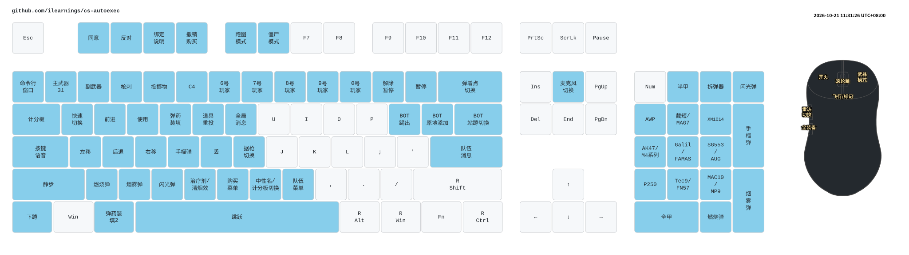
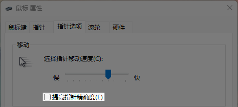

# autoexec.cfg

这是本人 Counter-Strike 系列游戏的硬件及 `autoexec.cfg` 配置参照.

> 参照信息:

- [新闻中心](https://store.steampowered.com/news/app/730)
- [Valve 开发者社区](https://developer.valvesoftware.com/wiki)
- [CS2指令合集(游戏内基本设置、实用指令)](https://www.bilibili.com/opus/919897577226240086) by ResoundXXXL on Bilibili

## 食用指南

打开终端并复制命令:

```zsh
git clone https://github.com/ilearnings/cs-autoexec.git
```

将 `cs-autoexec\` 文件夹中的文件复制到 `\<你的Steam文件夹>\steamapps\common\Counter-Strike Global Offensive\game\csgo\cfg\` 目录下即可

## 启动项(Steam)

```cfg
-perfectworld -high -nojoy -novid -refresh 170 -threads 16 -tickrate 128 +rate 786432
```

### 启动项(PWA)

```cfg
-perfectworld -high -nojoy -novid -refresh 170 -threads 16 -tickrate 128 +rate 786432 +exec autoexec.cfg
```

| 参数 | 说明 |
| :--- | :--- |
| `-perfectworld` | *开启国服 (二选一) |
| `-worldwide` | *开启国际服 (二选一) |
| `-high` | 高优先级 |
| `-nojoy` | 关闭遥杆 |
| `-novid` | 关闭开场动画 |
| `-refresh 170` | 强制刷新率 `<屏幕刷新率>` |
| `-threads 16` | 多线程优化 `<CPU线程数>` |
| `-tickrate 128` | 游戏采样速率 `<官匹64,非官匹128>` |
| `+exec FILE.cfg` | 执行 `<FILE.cfg>` 文件 |

## 按键绑定

[](https://raw.githubusercontent.com/ilearnings/cs-autoexec/main/images/bindings.svg)

## 鼠标



| 配置项 | 值 |
| :--- | :--- |
| Windows | 7 |
| DPI | 1000 |
| Hz | 1000 |

## 显卡

| 配置项 | 值 |
| :--- | :--- |
| 设置G-Sync | 以窗口和全屏模式启动 |

## 显示

| 配置项 | 值 |
| :--- | :--- |
| 增强角色对比度 | 启用 |
| V-Sync | 已启用 |
| NVIDIA G-Sync | 已启用 + 加速 |
| NVIDIA Reflex 低延迟 | 已启用 |
| 当前视频值预设 | 自定义 |
| 多重采样抗锯齿模式 | 2X MSAA |
| 全局阴影效果 | 低 |
| 动态阴影 | 全部 |
| 模型/贴图细节 | 低 |
| 贴图过滤模式 | 双线性 |
| 影细节 | 低 |
| 粒子细节 | 低 |
| 环境遮蔽光 | 高 |
| 高动态范围 | 品质 |
| Fidelity FX超级分辨率 | 已禁用(最高品质) |

## 已取消配置

```cfg
// 大跳
alias "+bjump" "+jump; +duck"
alias "-bjump" "-jump; -duck"
bind "SPACE" "+bjump"

// 向前一步跳投
alias "+forwardjumpaction" "+forward; +jump"
alias "-forwardjumpaction" "-jump; -forward"
alias "+throwaction" "-attack; -attack2"
bind "f" "+forwardjumpaction; +throwaction"

// 原地跳投
alias "+jumpaction" "+jump"
alias "+throwaction" "-attack; -attack2"
alias "-jumpaction" "-jump"
bind "MOUSE4" "+jumpaction; +throwaction"
```

---

## 开发指南

### 前置要求

- Linux / Windows
- Git
- uv

### 本地环境

```zsh
git clone https://github.com/ilearnings/cs-autoexec.git
cd cs-autoexec
uv sync --project keymap
```

`uv sync` 只在首次或依赖变更后执行

### 本地生成

```zsh
uv run --project keymap python keymap/main.py
```

一条命令完成: 解析 `autoexec.cfg` → 生成中间文件 → 渲染 SVG → 写入时间戳

产物:

- `keymap/keymap.yml`: 标签映射
- `images/bindings.svg`: 绑定图

可重复执行, 每次覆盖旧时间戳

### 本地预览

浏览器打开 `images/bindings.svg`

### 修改内容

只处理 `autoexec.cfg` 中 `bind` 开头的行, 用 `^...^` 标记按键标签:

```cfg
bind "a" "+forward" // ^左移^
```

无 `^...^` 的键显示键名 (灰色)

### 标签换行规则

`keymap/main.py` 按以下优先级拆分, 先命中先生效:

| 顺序 | 规则 | 示例 | 结果 |
| :--- | :--- | :--- | :--- |
| 1 | 已含 `\n` | `A\nB` | 原样 |
| 2 | 含 `/` | `AK47 / M4系列` | 两行 |
| 3 | 含中文 `-` | `滚轮-跳` | 两行 |
| 4 | 前缀 (`BOT` / `R Shift` 等) | `BOT原地添加` | 两行 |
| 5 | 纯中文 (含数字) | `中性名切换` | 两行 |
| 6 | 长度 > 6 | `ABCDEFG` | 两行 |
| 7 | 以上都不命中 | `AK47` | 原样 |

纯中文拆分: 3 字及以下不拆, 偶数均分, 奇数上排最多 3 字

纯中文标签超过 **8 字** 时打印警告 (本地终端 / Actions Annotations), 建议缩短

### 鼠标滚轮合并规则

为了让鼠标示意图更加简洁，`keymap/main.py` 对滚轮（`MWHEELUP` / `MWHEELDOWN`）做了特殊处理：

当两者绑定的描述**完全一致**时（例如都绑定为 `^滚轮跳^`），图形上会自动隐藏 `MWHEELDOWN`，并只显示一个居中的竖向排版描述（如“滚\n轮\n跳”）。
如果两者的描述**不一致**，则会自动分开渲染，各自显示在滚轮的上方和下方。

```cfg
// 触发合并
bind "MWHEELUP" "+jump" // ^滚轮跳^
bind "MWHEELDOWN" "+jump" // ^滚轮跳^

// 触发分开
bind "MWHEELUP" "+jump" // ^上跳^
bind "MWHEELDOWN" "+jump" // ^下跳^
```

### 提交并推送

```zsh
git add .
git commit -m "update bindings"
git push
```

push 后 Actions 自动运行 `keymap/main.py` 并提交产物

### 触发条件

仅当 push 到 `main` 且改动含 `autoexec.cfg` 时触发

改其他文件不触发, 如需手动跑一次, 在 GitHub 网页编辑 `autoexec.cfg` 的任意 `^...^` 标签并 commit

### 文件结构

```text
cs-autoexec/
├── .github/
│   ├── dependabot.yml                    ✅ Dependabot 更新配置
│   └── workflows/
│       ├── automerge.yml                 ✅ Dependabot PR 自动合并
│       └── update.yml                    ✅ 键位图生成工作流
├── autoexec.cfg                          ✅ 源配置
├── images/
│   ├── bindings.svg                      🔄 绑定图(自动生成)
│   └── mouse.png                         ✅ 鼠标配置截图
├── keymap/
│   ├── config.yml                        ✅ keymap-drawer 渲染配置
│   ├── keymap.yml                        🔄 中间产物(自动生成)
│   ├── layout.json                       ✅ 键盘物理布局
│   ├── main.py                           ✅ 解析 + 渲染 + 打时间戳
│   ├── pyproject.toml                    ✅ 依赖声明
│   └── uv.lock                           🔄 依赖锁定(自动生成)
└── README.md                             ✅ 说明文档
```
